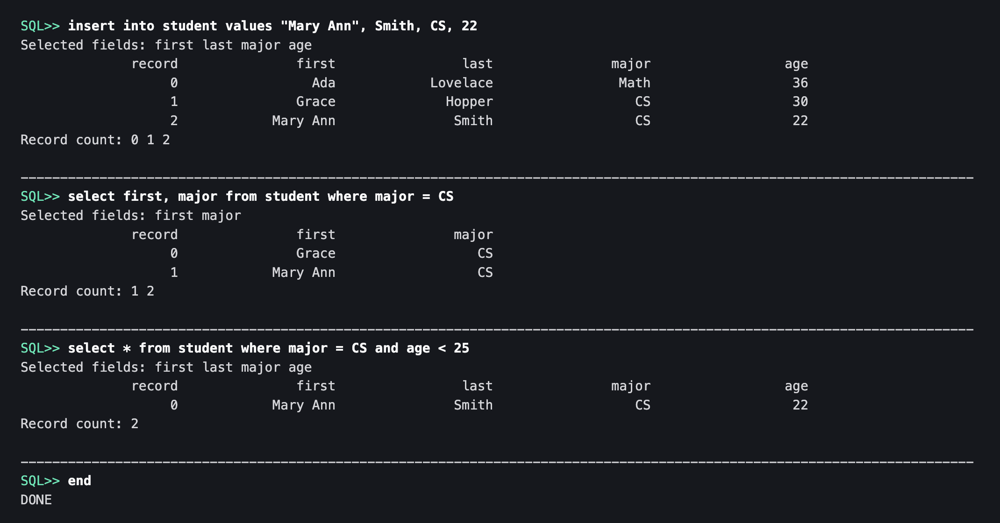

# SQL in C++

A small relational database engine written from scratch in C++17.
It parses a focused subset of SQL, stores each table in checksummed 4 KB pages, keeps a B+ tree index for every field, and recovers each statement atomically after a crash through a write-ahead log.

I wrote the first version in 2023 while learning C++ and rebuilt the storage engine in 2026.
The [`original-2023`](https://github.com/hskl18/SQL/tree/original-2023) tag keeps the first version.



*A session in the CLI from a local Release build, November 13, 2026.*

## Quick start

You need a C++17 compiler and CMake 3.20 or newer; the build downloads nothing.

```bash
cmake -S . -B build -DCMAKE_BUILD_TYPE=Release
cmake --build build --parallel
ctest --test-dir build --output-on-failure
./build/run_sql
```

Type `end` to exit and `cls` to clear the screen.

```text
SQL>> create table student fields first, last, major, age
SQL>> insert into student values Grace, Hopper, CS, 30
SQL>> select first, major from student where major = CS
```

## Architecture

<picture>
  <source media="(prefers-color-scheme: dark)" srcset="docs/architecture-dark.svg">
  
</picture>

The table answers a `WHERE` filter from the per-field B+ tree indexes after the shunting-yard step turns the filter into postfix form.
Each statement that changes a table first writes its complete after-image to `<table>.sql2-wal` and syncs it, and only then writes the changed pages to `<table>.sql2`.
Opening a table replays a complete WAL record, so a crash at any write leaves either the old table or the new one.

## What it supports

- `CREATE TABLE`, `INSERT INTO`, and `SELECT` with `*` or a field list.
- `WHERE` with `=`, `!=`, `<`, `<=`, `>`, `>=`, and `AND` and `OR` with parentheses.
- Tables that persist across CLI sessions, with page, index, and WAL corruption rejected on open.
- Batch runs from the sample command files in `batch/`.
- Copy-first migration from the 2023 fixed-width format.

It has no joins, multi-statement transactions, query planning, updates, or deletes, and it allows one writer at a time.
Values are stored and compared as strings, so `9` sorts after `10`.

## Tests

The CTest suite covers SQL behavior, parser safety, B+ tree splits, WAL ordering, a crash at every traced write and fsync, corruption rejection, recovery that can run twice, v1 migration, and the CLI.
Tests run in the build directory and leave no database files in the source tree.
CI runs a Release build and the suite on Linux.

## Documentation

- [Usage](docs/usage.md): the full grammar, the CLI's files and errors, storage inspection, v1 migration, limits, and the sanitizer build.
- [Design and invariants](DESIGN.md): the command path, source layout, and storage and query rules.
- [Storage format v2](docs/storage-v2.md): the byte layout, checksums, and recovery order.

## License

[MIT](LICENSE)
